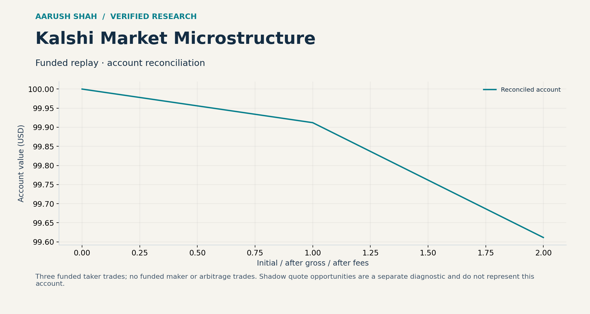

# Kalshi Market Microstructure

Conditional order-flow prediction, three-state first-passage modeling and joint execution research on prediction-market order books.

## Research highlights

- **77.06% next-taker-side prediction accuracy**, compared with **65.48%** for the unconditional baseline, across 1,260 overlapping scored windows.
- Event-driven Python framework covering **418,577 recorded messages** from a ten-market, 30-minute capture, including 11,248 trade messages.
- Estimated two-sided quote completion at **36.95% (235/636)**, quantifying joint fill probability and inventory exposure.
- Offline replay reproduced the preserved capture results and independently reconciled account cash and trade counts.

The prediction target is the next taker side. Price direction, three-state outcomes and executable P&L are evaluated separately. Overlapping windows share observations and are not independent trials.

## Explore the project

[Interactive research explorer](docs/explorer.html) — download and open the standalone HTML. GitHub displays the source.

## Research design

Rolling conditional distributions combine imbalance, flow and state history. Maker, taker and arbitrage experiments model fees, queue fills, slippage and an additional 5 ms action delay. Shadow quote episodes measure fill-risk scenarios; funded replay evaluates account accounting.

The selected result evaluates next taker side against its unconditional baseline. Quote-completion research models joint fills and inventory state.

[Complete experiment records](verification/) · [Technical explorer](docs/technical-explorer.html).

## Reproduce

~~~bash
python -m pip install -r requirements.txt
python -m unittest discover -s combined_paper -p 'test_*.py'
python -m unittest discover -s kalshi_paper -p 'test_*.py'
python -m unittest discover -s maker_project/maker_v2 -p 'test_*.py'
python reproduce.py
~~~

## Repository guide

- combined_paper/: combined engine, tests, raw capture and historical report.
- kalshi_paper/: first-passage engine and tests.
- maker_project/: flow distributions, queue/latency modeling and quote experiments.
- verification/: replay reconciliation and test logs.
- data/ and historical/: supplied market datasets and earlier research packages. Replay coverage is the active capture above; historical packages retain their original experiment configurations.
- [Methods and implementation review](docs/AUDIT.md) · [Dataset guide](docs/DATASETS.md).

By Aarush Shah.
