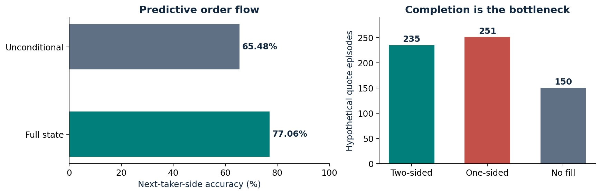

# Kalshi market microstructure

## Project visualization


[Open the interactive explorer](docs/explorer.html) — download and open this self-contained HTML in a browser. GitHub displays the source rather than running it. The explorer reads embedded audited results; full evidence and reproduction commands are below.


**A reproducible study of conditional order flow, first passage, and execution risk.**

The original 30-minute, ten-market capture was replayed from raw messages and matched the preserved result exactly. The central distinction is between predicting the next taker side and earning executable profit.

| Reproduced metric | Result | Interpretation |
|---|---:|---|
| Raw capture records | 418,577 | Includes lifecycle and control messages; 11,248 are trade messages |
| Next-side accuracy | 77.06% vs 65.48% | 1,260 scored overlapping windows; full state vs unconditional baseline |
| Two-sided quote completion | 235 / 636 = 36.95% | Hypothetical overlapping quote episodes, not funded maker trades |
| Funded paper P&L | -$0.3887 | $100 to $99.6113, three taker trades |
| Funded maker / arbitrage trades | 0 / 0 | No profitable strategy established by this run |



## Run it

```bash
python -m pip install -r requirements.txt
python -m unittest discover -s combined_paper -p 'test_*.py'
python -m unittest discover -s kalshi_paper -p 'test_*.py'
python -m unittest discover -s maker_project/maker_v2 -p 'test_*.py'
python reproduce.py
```

`reproduce.py` copies capture metadata and raw feed into `verification/replayed/`, runs the offline replay, and independently reconciles counts, weighted metrics, and cash. It preserves the historical run. No exchange orders are placed.

## Structure

- `combined_paper/`: original combined engine, tests, raw active capture, and historical report.
- `kalshi_paper/`: first-passage engine and its tests.
- `maker_project/`: empirical flow distributions, quote simulator, queue/latency rules, and tests.
- `diagnostics/`: imbalance-threshold diagnostic and original results.
- `data/`: recovered NFL BUF/JAC parquet order books and trades.
- `historical/`: original research packages, including MLB/NFL/BTC ZST data, model search, external validation, earlier pilots, and result plots.
- `verification/`: fresh replay reconciliation and test logs.
- `docs/`: verification visuals, data provenance, and limitations.

Historical packages retain their original filenames and internal layout. They are not all independently rerun. Open a ZIP to inspect its scripts, data, and original methodological notes; this archive status is distinct from the verified active replay.

## What the results do not establish

77.06% concerns **next taker side**, not price-direction accuracy or profitable trades. The 636 maker episodes overlap and assume separate hypothetical capacity; their summed -$12.30572 is a diagnostic, not portfolio P&L. The funded result comprises only three paper trades. Queue fills, depth haircuts, slippage, and fee rounding are modeled assumptions, not broker execution evidence. The 5 ms action delay is additional to observed feed latency. See [audit](docs/AUDIT.md) and [datasets](docs/DATASETS.md).

Author: Aarush Shah. Recovered original research with an independent reproducibility review, October 2026.
